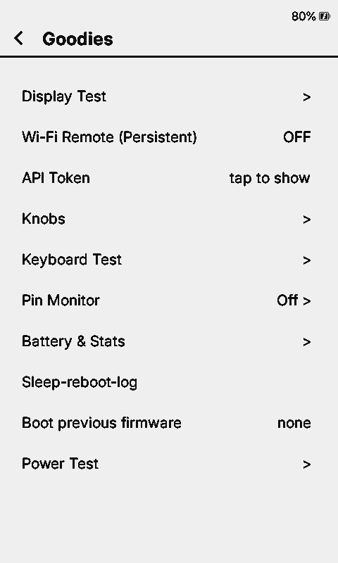

<h1 align="center">
  <picture>
    <source media="(prefers-color-scheme: dark)" srcset="eink-qemu/logo/eink-qemu-dark.svg">
    
  </picture>
</h1>

An emulator for **ESP32-based e-ink readers**: the **Xteink X4 Pro** (ESP32-S3R8,
16 MB flash, 8 MB octal PSRAM), the **BOOX Picco** (ESP32-S3), and the
**Xteink X3/X4** (ESP32-C3). It runs **unmodified stock firmware and any fork**,
including CrossInk, CrossDink and CrossPoint, or a bare ESP-IDF/Arduino app.
The screen, SD card, keys, touch, clock, battery gauge and
Wi-Fi all behave like the board, so you can develop firmware without the device.



Built on upstream **QEMU 11.1.2**, with the Espressif SoC models ported over.
The rule is that no firmware is ever changed to make it boot here: the hardware is modeled from datasheets and
from the real board instead.

eink-qemu started as a fork of [prokrypt/x4prosim](https://github.com/prokrypt/x4prosim)
by prokrypt, which first brought the Xteink X4 Pro up in QEMU: the board and its
peripherals, and the e-ink panel with its refresh and ghosting model. This
project builds on that work.

## Xteink X4 / TRMNL

Select **X4** in the browser before loading TRMNL's merged firmware `.bin`.
X3 and X4 both use ESP32-C3, so the chip header cannot distinguish them.
The browser remembers the selection; `?device=x4` also selects it.

For native or Node runs, prepare a flash image and select the board explicitly:

```sh
python3 eink-qemu/mkflash.py --machine x4 FW1.8.17.bin flash-x4.bin
X4MACHINE=x4 eink-qemu/run.sh flash-x4.bin sd.img
X4MACHINE=x4 eink-qemu/wasm/run-node.sh flash-x4.bin sd.img
```

Merged images preserve their bootloader, partition table, NVS and app bytes.
App-only X4 images use the bundled bootloader and CrossPoint partitions without
forcing X3 detection in NVS. CLI chip detection still defaults C3 to X3 for
compatibility; use `X4MACHINE=x4` for X4.

The X4 SSD1677 model supports framebuffer writes, RAM windows and active-high
BUSY. Refresh timing is simplified and ghosting is not modeled. The console
uses the device's 480×800 portrait orientation; TRMNL draws its setup interface
in landscape.

## BOOX Picco

Select **BOOX Picco** before loading a Picco app `.bin` in the browser, or use
`?device=picco`. ESP32-S3 chip detection alone defaults to X4 Pro, so Picco
requires an explicit board selection.

```sh
python3 eink-qemu/mkflash.py --machine picco picco1.0.2920.bin flash-picco.bin
X4MACHINE=picco eink-qemu/run.sh flash-picco.bin sd.img
X4MACHINE=picco eink-qemu/wasm/run-node.sh flash-picco.bin sd.img
```

The composer places the unchanged app at `0xE0000` using Picco's NVS, OTA,
recovery-slot and app layout. The recovery slot stays erased because an app
update does not contain recovery firmware. The remaining flash provides an
empty `spiffs` partition for LittleFS; this allocation is for the simulator.
Merged flash images retain their original layout and contents.

The board includes the SSD1677 display, Up/Down/Power keys, TMA525C touch,
SGM41562 charger, BM8563 RTC, QMI8658 motion sensor and SDMMC card. Display
waveforms and charging are simplified; frontlight brightness, multitouch and
touch-controller firmware updates are not simulated.

Host pointer taps last at least 100 ms of guest time so slower emulation does
not collapse a click between UI polls. Set `-global tma525c.host-touch-ms=0`
to disable this input timing adjustment; scripted QOM `touch` events remain
immediate.
The browser also keeps Picco's guest clock paced in Turbo mode so ordinary
clicks do not become long presses; display and bus timing still use the Turbo
settings. `?sleep=off` permits unpaced benchmarks.

## Porting layers

See [eink-qemu/porting/README.md](eink-qemu/porting/README.md) for the QEMU 11.1.2
porting branches, layer ownership, build command and commit rules.

## Downloads

CI builds every push for Linux (x86_64, arm64), macOS (Intel, Apple silicon) and
Windows, one archive per emulator (`xtensa-softmmu` = X4 Pro/Picco,
`riscv32-softmmu` = X3/X4). Get them from the latest run under
[Actions](../../actions) (artifacts `dist-qemu-*`), or from
[Releases](../../releases) for tagged versions. Each archive has `bin/`, the
`eink-qemu/` scripts and the docs; `eink-qemu/run.sh` finds `bin/` by itself.
Linux and macOS archives need the runtime libraries (glib, pixman, SDL2,
libslirp, libgcrypt, libpng) installed; the Windows one bundles them.

## WebAssembly build

The browser and Node builds use a wasm64 JIT, compiling hot guest blocks to
WebAssembly while cold blocks run through TCI. Try the
[browser demo](https://serialx.github.io/eink-qemu/), download the
`eink-qemu-<version>-wasm` Actions artifact, or build with Emscripten 6.0.12:

```sh
eink-qemu/wasm/build-deps.sh
eink-qemu/wasm/build.sh --web
python3 eink-qemu/wasm/serve.py build-wasm-32limit/web-dist
```

The default `MEMORY64=2` mode uses 32-bit memory addressing for compatibility
with modern Chrome, Firefox and Safari. `WASM64_MODE=64` selects native
Memory64 (Chrome 133+, Firefox 134+, not Safari); both use 64-bit host pointers.
Chrome 155 and Node 26 are verified; Firefox/Safari emulator runs are untested.
Threads require cross-origin isolation, provided by the local server or the
bundled service worker on HTTPS hosting.

The browser page defaults to **Turbo (fast, not timing-accurate)**: the
checkbox starts ticked, and unticking it or `?turbo=0` selects accurate timing
(`?turbo=1` remains accepted). The Node launcher keeps accurate timing by
default; `TURBO=1 eink-qemu/wasm/run-node.sh flash.bin sd.img` opts in.

Five quiet alternating pairs on an Apple M5 Max (Node 26, Chrome 155,
`MEMORY64=2`, `sleep=off`) compare `5ea1b8ef2e` with the six-change performance
stack. CrossPoint 1.6.5 X3 accurate startup settles in **7.518 s in Node** and
**8.961 s in Chrome**, with paired post-Home reductions of **20.8%** and **30.2%**.
Chrome's gain includes settling before the ten-second autosave; the baseline
incurred one 60–63 ms save pause. X3 waits, first MEM and whole SD contents are
unchanged, and panels match at equal virtual time. Turbo changes guest timing
and is measured separately.
Official X4 Pro firmware also passed native, Node and Chrome acceptance;
Safari/Firefox remain untested.
See [the full WebAssembly guide](EINK-QEMU.md#webassembly-build) for build modes,
measurement methods, limits and upstream candidates.

## Quick start

Use Python 3.9 or newer, GLib 2.66 or newer, and libgcrypt 1.9.4 or newer
(Debian 12 satisfies these requirements). QEMU configure selects Meson 1.5 or
newer, installing the bundled 1.11.1 wheel when needed. Rust is disabled by
default in this QEMU 11.1.2 tree; no Rust toolchain is needed for these builds.
A fresh configure needs network access for missing Python packages and subprojects.

```sh
# deps (Debian/Ubuntu)
sudo apt install build-essential git pkg-config ninja-build libglib2.0-dev \
  libpixman-1-dev libpng-dev libgcrypt20-dev libslirp-dev libsdl2-dev \
  dosfstools mtools python3 python3-venv
python3 -m venv .venv && . .venv/bin/activate
python3 -m pip install esptool
mkdir build && cd build
../configure --target-list=xtensa-softmmu,riscv32-softmmu --enable-gcrypt --enable-slirp --enable-sdl --enable-png \
  --disable-gnutls --disable-strip --disable-user --disable-capstone --disable-vnc --disable-gtk --disable-docs
ninja qemu-system-xtensa qemu-system-riscv32 && cd ..

eink-qemu/mkflash.sh <pio or idf build dir> flash.bin   # bootloader + partitions + app -> 16 MB image
eink-qemu/run.sh flash.bin sd.img                       # SDL window, firmware log on stdout
```

`run.sh`, `drive.py` and `mkflash.sh` pick the machine from the image's chip:
an ESP32-S3 image runs on `x4pro`, an ESP32-C3 image (the CrossPoint X3/X4
binary) defaults to `x3`. Set `X4MACHINE=x4` in the launchers and
`--machine x4` in the composer for X4.

A flash dump of a real device works too, as long as it doesn't use flash
encryption: `esptool.py --chip esp32s3 read_flash 0 0x1000000 flash.bin`.
`sd.img` is created on first run (2050 MiB FAT32, 32 KiB clusters).
`eink-qemu/mksd.py sd.img 2050 books/` creates an image populated from a folder.
See [SD image geometry](#sd-image-geometry) before comparing hardware timings.

**Controls:** arrow keys are Up/Down and `P` is Power. Click in the window to
touch. On the X3, Left/Right, Enter (Confirm) and Backspace (Back) are keys too.
Monitor: `socat - unix:/tmp/eink-qemu-mon.sock`.

**Headless / scripted:**
```sh
eink-qemu/drive.py flash.bin sd.img log.txt wait:30 press:down shot:home.png \
  "hmp:qom-set /machine/gt911 tap 240,529" wait:5 shot:settings.png
```

## SD image geometry

```sh
python3 eink-qemu/mksd.py sd.img [size_mb] [dir_to_copy] [--cluster-size BYTES]
```

The default is a 2050 MiB image with an MBR, a FAT32 partition starting at
1 MiB, and **32 KiB clusters** (64 sectors of 512 bytes). This cluster size
matches the stock SD card supplied with the Xteink X3 that was measured on
hardware. Sizes are in MiB despite the `size_mb` argument name. The image is
sparse on supporting host filesystems; copying or loading it into memory can
still consume its full logical size. Existing images are not converted.

For hardware timing comparisons, match the card's filesystem geometry as
well as its book, font and settings files. Small clusters require more FAT
chain traversal when firmware seeks within large font files. A 128 MiB image
with automatically chosen 512-byte clusters made font prewarming slower in
simulated time than on the stock card. Check geometry before tuning CPU or
SD latency parameters; identical file contents alone are insufficient.

FAT32 needs at least 65,525 data clusters. With 32 KiB clusters this helper
requires at least 2050 MiB and rejects smaller requests before writing the
image. Compact functional-test images must opt into another cluster size:

```sh
python3 eink-qemu/mksd.py compact-sd.img 64 --cluster-size 512
```

The browser's bundled 64 MiB card and ROM/filesystem smoke fixtures use this
explicit exception to keep their memory and download sizes small. They do
**not** represent the stock X3 card's filesystem timing. Use a suitable image
for timing measurements, and record its filesystem type and cluster size.

## What's emulated

| Part | Model | Status |
| --- | --- | --- |
| CPU, flash, PSRAM | ESP32-S3 dual core, 16 MB flash, 8 MB octal PSRAM | done |
| Display | UC8179 800x480 e-ink: identity/OTP probe, register LUTs, animated refreshes, physical ghosting fitted to device photos | done |
| SD card | SDMMC, FAT32 image | done |
| Keys | Up, Down, Power (GPIO, wake from light sleep) | done |
| Touch | GT911 on I2C | done |
| Clock | BM8563 RTC on I2C | done |
| Battery | CW2017 fuel gauge on I2C | done |
| Wi-Fi | emulated MAC + a fake open AP (`PICSimLabWifi`), bridged to the host network | done |
| Light sleep | RTC timer and GPIO wake | done |
| Frontlight, charger STAT, deep sleep, USB OTG | | not yet |

The **X3** (`-machine x3`, `qemu-system-riscv32`): UC8279d or UC8253 792x528
e-ink, SD card in SPI mode, the six keys on their ADC ladder plus Power,
BQ27220 gauge, DS3231 clock, QMI8658 IMU, the same Wi-Fi, and deep sleep with
power-button wake. The panel uses the X4 Pro's ink and ghosting model,
including animated refreshes, with X3 waveform decoding and calibrated
refresh timing. Details in [EINK-QEMU.md](EINK-QEMU.md).

**Wi-Fi.** Join `PICSimLabWifi` on the device. By default it uses QEMU's NAT:
the device gets 10.0.2.15, and `curl localhost:8080` reaches its port 80. To
put it on your LAN, so it gets an address from your router, run with
`X4BR=br0` on a host bridge (setup in [EINK-QEMU.md](EINK-QEMU.md)).

**Panel.** Ghosting is **off by default in native and Node CLI runs** for stable
pixel comparisons. Enable it with `-global uc8179.ghosting=on` (X4 Pro) or
`-global uc8279.ghosting=on` (X3). The web page defaults to **Ghosting on**;
untick the switch before starting, or use `?ghosting=0`, for clean pixels.
Ghosting off removes physical ink artifacts and idle drift while retaining LUT
grayscale and refresh timing. `-global uc8179.animate=false` independently skips
animation; use the `uc8279` prefix for X3. Capture after refresh completion when
comparing pixels. See [eink-qemu/ghosting/README.md](eink-qemu/ghosting/README.md).

## Docs

- [EINK-QEMU.md](EINK-QEMU.md): the full guide. It covers building firmware for
  the sim, debugging a hang with gdb, every model and its options, the X4 Pro
  pin map, what's still missing, and how to contribute a peripheral.
- [eink-qemu/testdata/](eink-qemu/testdata/README.md): real device logs, the
  panel OTP and battery history, for checking a simulated run against the
  device.
- [eink-qemu/ghosting/](eink-qemu/ghosting/README.md): how the e-ink model works,
  its calibration against photos, and step files and tools for repeating it.

## Contributing

Branch off `main`, keep one peripheral per PR, and use commit messages of
the form `eink-qemu: <what>`. Read the workflow section of
[EINK-QEMU.md](EINK-QEMU.md) first.

## License and credits

- This project began as a fork of [prokrypt/x4prosim](https://github.com/prokrypt/x4prosim)
  by prokrypt: the X4 Pro machine, its peripherals and the UC8179 panel model.
- The cow logo is in [eink-qemu/logo](eink-qemu/logo).
- QEMU is GPL-2.0; see [COPYING](COPYING) and [LICENSE](LICENSE). The original
  QEMU README is [README.rst](README.rst).
- The ESP32 SoC models come from Espressif's QEMU fork.
- The Wi-Fi MAC and access-point emulation is adapted from lcgamboa's ESP32
  QEMU work. The AP code is by Clemens Kolbitsch, modified for the ESP32 by Martin
  Johnson (MIT); see the file headers.
