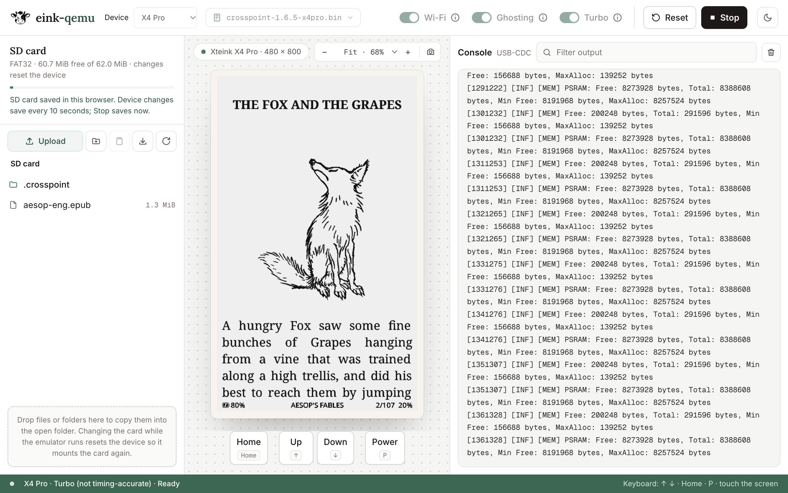

<h1 align="center">
  <picture>
    <source media="(prefers-color-scheme: dark)" srcset="eink-qemu/logo/eink-qemu-dark.svg">
    
  </picture>
</h1>

eink-qemu emulates **ESP32-based e-ink readers** so you can run and debug their
firmware without the device. It runs **unmodified firmware**: the stock
firmware, CrossPoint, CrossInk, CrossDink, TRMNL, or your own ESP-IDF or
Arduino app. The screen, SD card, keys, touch, clock, battery gauge and Wi-Fi
behave like the real board. No firmware is ever patched to boot here; the
hardware is modeled from datasheets and measurements of real devices.

**Try it now in your browser:** https://serialx.github.io/eink-qemu/

<a href="https://serialx.github.io/eink-qemu/"><picture>
  <source media="(prefers-color-scheme: dark)" srcset="eink-qemu/screenshots/browser-dark.png">
  
</picture></a>

eink-qemu is upstream QEMU 11.1.2 with Espressif's ESP32 SoC models, the Xteink
X4 Pro board and panel models from [prokrypt/x4prosim](https://github.com/prokrypt/x4prosim),
and Kohei Tokunaga's WebAssembly JIT. Where each piece came from is in
[Origins](#origins).

## Supported boards

| Board | SoC | Machine | Emulator binary | Fidelity |
| --- | --- | --- | --- | --- |
| Xteink X4 Pro | ESP32-S3 | `x4pro` | `qemu-system-xtensa` | Full board; CPU, PSRAM, SD, SPI and UC8279 timing [calibrated on a real X4 Pro](eink-qemu/x4cal/README.md) |
| Xteink X3 | ESP32-C3 | `x3` | `qemu-system-riscv32` | Full board, SD, panel and CPU timing calibrated on a real X3 |
| Xteink X4 | ESP32-C3 | `x4` | `qemu-system-riscv32` | Runs firmware; panel refresh timing simplified, no ghosting |
| BOOX Picco | ESP32-S3 | `picco` | `qemu-system-xtensa` | Runs firmware; panel waveforms and charging simplified |

The launchers pick the board from the firmware's chip: an ESP32-S3 image runs
as the X4 Pro and an ESP32-C3 image as the X3. **The X4 and the Picco must be
selected explicitly**, because their chips match the other boards.

## Try it in the browser

1. Open https://serialx.github.io/eink-qemu/ in Chrome. Firefox and Safari are
   untested.
2. Choose the **Device**. Auto works for the X4 Pro and the X3. Pick **X4** or
   **BOOX Picco** for those boards.
3. Choose the **Firmware**: an official CrossPoint release `.bin`, a merged
   firmware `.bin`, an X4 Pro `.xota` update, or a 16 MiB flash dump. The
   emulator starts as soon as the file loads.

Use the arrow keys, Enter, Esc and `P` (Power). On boards with a touchscreen,
click the screen to touch it. The SD card panel lets you add books, swap in
your own card image, and download the card.

The page starts with **Turbo** on, which runs fast but not with real device
timing. Turn it off, or open the page with `?turbo=0`, for accurate timing.
**Ghosting** is on to show real e-ink artifacts. Turn it off, or use
`?ghosting=0`, when you need clean pixels.

## Run it on your computer

### Get the emulator

Download an archive from [Releases](../../releases), or from the latest
[Actions](../../actions) run (artifacts `dist-qemu-*`). Builds cover Linux
(x86_64, arm64), macOS (Intel, Apple silicon) and Windows. Each archive holds
one emulator: `xtensa-softmmu` for the X4 Pro and Picco, `riscv32-softmmu` for
the X3 and X4. Linux and macOS need glib, pixman, SDL2, libslirp, libgcrypt and
libpng installed; the Windows archives bundle them.

To build from source instead, use Python 3.9+, GLib 2.66+ and libgcrypt 1.9.4+
(Debian 12 has all three). The first configure needs network access to fetch
Python packages and subprojects. No Rust toolchain is needed.

```sh
# deps (Debian/Ubuntu)
sudo apt install build-essential git pkg-config ninja-build libglib2.0-dev \
  libpixman-1-dev libpng-dev libgcrypt20-dev libslirp-dev libsdl2-dev \
  dosfstools mtools python3 python3-venv
python3 -m venv .venv && . .venv/bin/activate
python3 -m pip install esptool
mkdir build && cd build
../configure --target-list=xtensa-softmmu,riscv32-softmmu --enable-gcrypt --enable-slirp --enable-sdl --enable-png \
  --disable-gnutls --disable-strip --disable-user --disable-capstone --disable-vnc --disable-gtk --disable-docs
ninja qemu-system-xtensa qemu-system-riscv32 && cd ..
```

### Run your firmware

Compose a 16 MiB flash image, then start the emulator. `mkflash.py` accepts an
app `.bin`, a merged `.bin`, a PlatformIO or ESP-IDF build directory, or a flash
dump. A merged image keeps its own bootloader, partitions and data; an app gets
the bundled bootloader and the board's partition table.

```sh
python3 eink-qemu/mkflash.py crosspoint-1.6.5-x3-x4.bin flash.bin
eink-qemu/run.sh flash.bin sd.img        # SDL window, firmware log on stdout
```

X4 Pro defaults to the measured UC8279 revision `0x68` panel in native, Node,
and browser runs. For a reader with the older panel, use
`X4PANEL=uc8179 eink-qemu/run.sh flash.bin sd.img`; the same variable works
with `drive.py` and the Node launcher. In the browser, the **X4 Pro panel**
selector preserves saved choices; turn off Turbo to use measured panel delays.
See the [calibration report](eink-qemu/x4cal/README.md)
for measured CPU, SDMMC, SPI, panel and sleep timing, and the remaining cache
and optical limits. X4 Pro launchers use `icount shift=0` with these defaults.

For the X4 or the Picco, name the board in both steps:

```sh
python3 eink-qemu/mkflash.py --machine picco picco1.0.2920.bin flash-picco.bin
X4MACHINE=picco eink-qemu/run.sh flash-picco.bin sd.img
```

A dump of a real device works too, as long as it doesn't use flash encryption:
`esptool.py --chip esp32s3 read_flash 0 0x1000000 flash.bin`.

`run.sh` creates `sd.img` on first run, an empty card shaped like the stock X3
card. To start with books on it, build one from a folder with
`python3 eink-qemu/mksd.py sd.img 2050 books/`.

**Controls:** arrow keys are Up and Down, and `P` is Power. Click in the window
to touch. On the X3, Left, Right, Enter (Confirm) and Backspace (Back) work too.
The QEMU monitor is at `socat - unix:/tmp/eink-qemu-mon.sock`.

**Scripted runs** take key presses, touches and screenshots without a window:

```sh
eink-qemu/drive.py flash.bin sd.img log.txt wait:30 press:down shot:home.png \
  "hmp:qom-set /machine/gt911 tap 240,529" wait:5 shot:settings.png
```

## What's emulated

The X4 Pro:

| Part | Model | Status |
| --- | --- | --- |
| CPU, flash, PSRAM | ESP32-S3 dual core, 16 MB flash, 8 MB octal PSRAM | done |
| Display | UC8179 800x480 e-ink: identity/OTP probe, register LUTs, animated refreshes, physical ghosting fitted to device photos | done |
| SD card | SDMMC, FAT32 image, measured command/DMA/card delays | done |
| Keys | Up, Down, Power (GPIO, wake from light sleep) | done |
| Touch | GT911 on I2C | done |
| Clock | BM8563 RTC on I2C | done |
| Battery | CW2017 fuel gauge on I2C | done |
| Wi-Fi | emulated MAC + a fake open AP (`PICSimLabWifi`), bridged to the host network | done |
| Light sleep | RTC timer and GPIO wake | done |
| Deep sleep | RTC timer wake, retained memory, both-core restart; boot latency approximate | timer wake |
| Frontlight, charger STAT, ext0/ext1 deep-sleep wake, USB OTG | | not yet |

**The X3** has a UC8279d or UC8253 792x528 panel, an SD card in SPI mode, six
keys on an ADC ladder plus Power, a BQ27220 gauge, a DS3231 clock, a QMI8658
IMU, the same Wi-Fi, and deep sleep with power-button wake. Its panel uses the
X4 Pro's ink and ghosting model with X3 waveforms. SD card and SPI bus
latencies, panel refresh times and CPU instruction costs were measured on a
real X3 and fitted; see [eink-qemu/sdcal](eink-qemu/sdcal/README.md).

**The X4 and the Picco** are covered in their own sections of
[EINK-QEMU.md](EINK-QEMU.md), with their peripherals and limits.

**Wi-Fi.** Join `PICSimLabWifi` on the device. By default it sits behind QEMU's
NAT: the device gets 10.0.2.15, and `curl localhost:8080` reaches its port 80.
To put it on your LAN with an address from your router, run with `X4BR=br0` on
a host bridge, set up as described in [EINK-QEMU.md](EINK-QEMU.md).

**Ghosting** is off by default in native and Node runs, so screenshots compare
pixel for pixel. Turn it on with `-global uc8179.ghosting=on` on the X4 Pro or
`-global uc8279.ghosting=on` on the X3. With ghosting off the panel still
renders LUT grayscale and keeps real refresh timing. `-global uc8179.animate=false`
skips the refresh animation, with the `uc8279` prefix on the X3. When comparing
pixels, capture after the refresh completes. The model is explained in
[eink-qemu/ghosting](eink-qemu/ghosting/README.md).

## Comparing timing with a real device

Match the SD card's filesystem, not just its files. The firmware walks FAT
cluster chains when it seeks in large font files, so smaller clusters make it
slower. A 128 MiB image with 512-byte clusters made font prewarming slower than
on the stock card.

`mksd.py` defaults to a 2050 MiB FAT32 image with **32 KiB clusters**, the
geometry of the stock X3 card. FAT32 needs at least 65,525 clusters, so that is
also the smallest size it accepts at 32 KiB. Smaller test images must choose a
smaller cluster size and are not valid for timing:

```sh
python3 eink-qemu/mksd.py compact-sd.img 64 --cluster-size 512
```

The browser's bundled 64 MiB card is one of these compact images. Sizes are in
MiB. Images are sparse where the host filesystem supports it, but copying one
can still take its full size. Use accurate timing, not Turbo, and record the
card's geometry with any measurement.

For identical input trees and geometry, `mksd.py` produces byte-identical images
with the same dosfstools/mtools versions. It fixes the FAT volume ID to
`45494e4b`, pins all FAT timestamps to 1980-01-01 00:00:00 UTC, and copies entries
in sorted order at every directory level. Source timestamps are unchanged;
the builder overrides `SOURCE_DATE_EPOCH` and `TZ` for its child processes.
Timestamp pinning requires mtools 4.0.20 or newer.

## Building for the browser and Node

The WebAssembly build compiles hot guest code to WebAssembly with a JIT and
runs cold code in an interpreter. Download the `eink-qemu-<version>-wasm`
Actions artifact, or build it with Emscripten 6.0.12:

```sh
eink-qemu/wasm/build-deps.sh
eink-qemu/wasm/build.sh --web
python3 eink-qemu/wasm/serve.py build-wasm-32limit/web-dist
```

`eink-qemu/wasm/run-node.sh flash.bin sd.img` runs the same build in Node 26,
with accurate timing unless you set `TURBO=1`. Chrome 155 and Node 26 are
verified; Firefox and Safari runs are untested. Build modes, browser
requirements, benchmarks and limits are in the
[WebAssembly guide](EINK-QEMU.md#webassembly-build).

## Docs

- [EINK-QEMU.md](EINK-QEMU.md): the full guide. It covers building firmware
  for the emulator, debugging a hang with gdb, every model and its options, the
  X4 Pro pin map, the WebAssembly build, and what's still missing.
- [eink-qemu/sdcal](eink-qemu/sdcal/README.md): how the X3's SD, panel and CPU
  timing was measured and fitted.
- [eink-qemu/ghosting](eink-qemu/ghosting/README.md): how the e-ink model
  works, its calibration against photos, and tools for repeating it.
- [eink-qemu/testdata](eink-qemu/testdata/README.md): real device logs, the
  panel OTP and battery history, for checking a run against the device.

## Contributing

Read the workflow section of [EINK-QEMU.md](EINK-QEMU.md) first. Branch off
`main`, keep one peripheral per pull request, and write commit messages as
`eink-qemu: <what>`. How the QEMU 11.1.2 port is layered is in
[eink-qemu/porting](eink-qemu/porting/README.md).

## Origins

eink-qemu descends from several lines of work. All of it is GPL-2.0 QEMU code
except where noted.

- **QEMU.** The tree is upstream [QEMU](https://www.qemu.org/) v11.1.2,
  released 2026-09-28.
- **Espressif's QEMU fork.** The ESP32, ESP32-S3 and ESP32-C3 SoC models and
  their peripherals come from [espressif/qemu](https://github.com/espressif/qemu)
  (branch `esp-develop`). Espressif wrote them against QEMU 9.2.2; eink-qemu
  re-ported them onto 11.1.2 in October 2026, layer by layer, as described in
  [eink-qemu/porting](eink-qemu/porting/README.md). The pre-port history is
  kept on the `legacy-esp-develop` branch. That fork also carries community
  models: ESP32 I2C by Peter Buchegger, RSA by Sachin Billore, AES and LEDC by
  Maksim Naumenko, and the ESP32-S3 SDMMC controller by Throows.
- **Wi-Fi.** The access-point code is Clemens Kolbitsch's 2008 QEMU work (MIT),
  adapted to the ESP32 by Martin Johnson in 2022 and to the ESP32-C3, ESP-NOW
  and SoftAP by lcgamboa for [PICSimLab](https://github.com/lcgamboa/picsimlab)
  in 2023, which is why the fake network is called `PICSimLabWifi`. x4prosim
  ported it to the ESP32-S3. See the file headers in `hw/misc`.
- **prokrypt/x4prosim.** prokrypt started
  [x4prosim](https://github.com/prokrypt/x4prosim) on 2026-10-08 as a fork of
  Espressif's QEMU, to run CrossDink on the Xteink X4 Pro without the device:
  the `x4pro` machine, its GPIO, SPI, I2C, touch, RTC and gauge models, and the
  UC8179 panel with its refresh animation and ghosting model fitted to device
  photos. eink-qemu forked it the same day, after contributing the Xteink X3
  machine and its SD, panel and CPU timing calibration upstream.
- **qemu-wasm.** The browser build rests on Kohei Tokunaga's
  [qemu-wasm](https://github.com/ktock/qemu-wasm). His Emscripten and wasm64
  host support is in upstream QEMU; his wasm64 TCG JIT backend, which compiles
  hot guest code to WebAssembly at runtime and makes the browser build fast, is
  not upstream yet and is merged here from his `wasm64-tcg-b` branch.

Much of the code in both x4prosim and eink-qemu was written with Claude Code
and Codex under human direction. Commit trailers name the sessions.

## License and credits

- QEMU is GPL-2.0; see [COPYING](COPYING) and [LICENSE](LICENSE). The original
  QEMU README is [README.rst](README.rst).
- The Wi-Fi access-point code and the wasm64 TCG backend are MIT; see the file
  headers.
- The cow logo is in [eink-qemu/logo](eink-qemu/logo).
