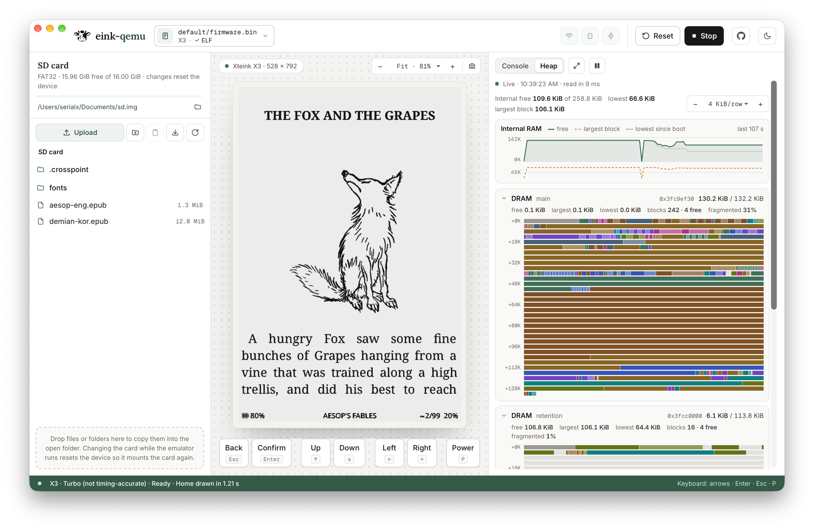

# eink-qemu desktop

A Tauri app that runs native QEMU: SD card explorer, device stage, firmware
console and a live heap view. Its front end (`src/`) is also the browser
page: one TypeScript app over two backends, the Rust commands here and the
WebAssembly build in a runtime iframe (`pnpm build:browser`, below). The
stylesheet, fonts, marks and firmware modules come from `../wasm/web`. Design
notes are in [DESIGN.md](DESIGN.md).



## Run

Build QEMU first ([EINK-QEMU.md](../../EINK-QEMU.md#build-and-run)); in
development the app runs `build/qemu-system-riscv32` and
`build/qemu-system-xtensa` from the repository root, or the directory in
`EINK_QEMU_BIN`. QEMU must include the `eink` display (`ui/eink.c`). Then,
with Node 22.12+, pnpm 10+ and Rust 1.90+:

```sh
cd eink-qemu/desktop
pnpm install
pnpm tauri dev
```

`pnpm dev` and `pnpm build` first run `scripts/prepare-resources.sh`, which
needs Python 3. It writes the boot assets for composing release apps to
`public/boot/`. SD cards are formatted in Rust, so no FAT tools are needed.

The Rust code is a Cargo workspace: `src-tauri` is the app, `core` the
emulator session, display reader, heaps, SD cards and flash images it shares
with the command-line tool in `cli` (see [cli/README.md](cli/README.md)).

Checks:

```sh
pnpm exec tsc --noEmit    # front end
cargo test --workspace    # display reader, locks, heaps, SD card, flash, CLI
```

`pnpm dev` alone serves the front end in a browser at
http://localhost:1420 with mock content, for layout work without Rust;
`?demo` shows the same mock content inside the app.

## The browser page

`pnpm build:browser` builds the same front end for the browser into
`dist-web/`: relative URLs for static hosting, the page's classic scripts
(`fat.js`, `sd-ops.js`, `sd-store.js` and the isolation service worker)
loaded by `index.html`, and the boot assets under `boot/`.
`eink-qemu/wasm/package-web.sh` runs it and lays the result over the runtime
iframe's files, the wasm binaries and the Wi-Fi assets. The browser has no Heap
tab and no ELF (reading the guest's memory needs native QEMU), the card menu
opens an image or the bundled blank card, and the SD card is saved in the
browser; everything else is the same page.

`pnpm dev:browser` serves the page from source at http://localhost:1421/ with
the isolation headers, taking the runtime's files from `../wasm/web` and the
wasm package from `EINK_WEB_DIST` (default `../../build-wasm-32limit/web-dist`,
or the `eink-qemu-<version>-wasm` Actions artifact unpacked anywhere).

## Behaviour

The top bar's firmware chip names the firmware, its device and whether its
ELF is loaded; it opens the firmware card. The card shows the file (chip,
app version, size, date), offers only the devices that take its chip (X3 and
X4 for ESP32-C3, X4 Pro and Picco for ESP32-S3), holds the ELF for the Heap
tab, the X4 Pro's display panel, and recent firmware. Each firmware keeps the
device and ELF it last used, so `.pio/build/default` comes back as an X3 and
`.pio/build/x4pro` as an X4 Pro. When a firmware is chosen, an ELF beside it
(the same name with `.elf`, or `firmware.elf`, as PlatformIO and ESP-IDF
write) is taken up when its app descriptor shows it built that firmware; one
from another build is left out and the card says so. Wi-Fi, Ghosting and Turbo
are the icon toggles beside Start; their tips say what each does.

These persist in `settings.json`, with the SD card, in the app's config
directory. Theme and zoom stay in the WebView's storage, as on the page, with
the desktop's panel widths; that storage is shared by every instance.
Choosing a firmware starts it, as in the browser; changing its device or the
X4 Pro panel restarts it.

The SD card is an image file that QEMU opens directly: `sd.img` in the app's
data directory unless another card is opened from the card menu, which also
makes new blank cards and resizes the open one. Cards are sparse files, so the
16 GiB card made on first run starts at about 5 MiB on disk and grows as
files are written; "Save a copy" keeps the copy sparse, but copying the file
elsewhere by hand may write it out in full. Every card is MBR + FAT32 with the
stock X3 card's 32 KiB clusters, from 2 GiB (the stock card's 2050 MiB, the
one for timing comparisons: see the repository README's SD image geometry
section) to 32 GiB; X3 and X4 Pro firmware reaches Home at the same moment on
16 GiB as on 2050 MiB. Where the disk cannot hold sparse files, a new card is
128 MiB with 1 KiB clusters instead, and the app says so. Resizing copies
every folder and file, with file times, into a new card of the chosen size,
which takes the old one's place; folder times become the time of the copy. The explorer
edits the image in Rust with the `fatfs` crate. While the emulator runs, each
operation pauses the guest; a change resets the device so the firmware mounts
the card again. Uploads take files from the native dialog, or files and
folders dropped on the panel; hidden entries and symbolic links in folders
are skipped. The card's path keeps its file name in view, and the folder
button beside it shows the image in Finder (File Explorer, the file manager).
A card is used by one app instance at a time; an instance that
cannot lock its card opens without one and says so. A saved card that is
missing or invalid, a saved firmware file that is missing, and a settings
file that cannot be read are reported when the window opens; firmware
contents are checked at Start.

The output panel's Heap tab maps the running firmware's ESP-IDF 5.x heaps
block by block: internal DRAM, RTC and PSRAM, each wrapped into rows at a
scale the tab's − and + choose (every heap at the same scale, or Fit), with
new allocations and frees highlighted, requested sizes and corrupt canaries
(with the default light heap poisoning) and fragmentation. A heap's header
folds its map to a single bar; empty heaps (the C3's retention and boot-ROM
heaps, until the main one fills) start folded. Above the maps, a trend shows
internal RAM's free memory, lowest point since boot and largest free block
for the run. Clicking or dragging on the trend (or the arrow keys on it)
looks back: the maps show the heaps at that moment, lit where they changed
since the second before, until Live, Escape or the trend's last point. Clicking a block opens its details under its map: addresses,
sizes, age and, with allocation stacks, the whole call stack, which can be
copied. The maps work without an ELF: the heap list is then found by
scanning internal DRAM, and blocks are not coloured by site. The ELF the
firmware was built from, found beside the firmware, chosen in the firmware
card or the tab, or dropped on the window, is remembered in `settings.json`;
a rebuilt ELF is read again. The ELF must be
the running app's: the image records its ELF's SHA-256 (PlatformIO and
ESP-IDF builds both write it), and with a different ELF the tab names both
builds and shows the heaps without it. While the tab or the heap window is open, each second Rust
stops the guest, copies the heap regions through QMP `pmemsave` and resumes;
under `-icount` the guest does not see the pause, and the tab shows how long
the read took. "Largest block" is the TLSF block size, slightly above the
firmware's `heap_caps_get_largest_free_block()`.

When the ELF is chosen before Start and matches the firmware, QEMU also loads
the heaptrace plugin (`contrib/plugins/heaptrace.c`), which logs every
allocation and free with its call stack. The tab then colours each block by
the function that allocated it, naming it on hover. Stacks are symbolized in
Rust from the ELF's DWARF, so no toolchain is needed.

The heap window (the tab's expand button) is a workbench over the same heaps.
On the left, the allocation sites, sortable by live bytes, blocks,
allocations a second and change over the last minute, with a filter; hovering
one lights its blocks on the maps, and selecting one shows its trend, the call
stack holding most of its bytes and its newest blocks in the inspector on the
right. Clicking a block shows its details there. Along the bottom, a timeline
of internal free memory and of allocations and frees replays the heaps from
the log to any event since boot: drag on it, step with the arrow keys, or play
at 1× or 10×. Mark A (or Shift-click the timeline) compares that moment with
the cursor, B, which follows live until moved: the sites by what they gained,
the maps by what is new since A and what was freed. Without the plugin (an
ELF chosen after Start, a firmware without heap poisoning, or a QEMU built
without `--enable-plugins`) the tab says why, and the window shows the heaps
alone; its timeline then steps through the snapshots Rust keeps, and
comparing two of them still shows what changed.

Wi-Fi uses QEMU's user network, so the firmware reaches the internet; turning
it off keeps the radio present without a host connection. Turbo uses the
overrides from `turbo-args.sh`, like the other launchers, but keeps idle time
in real time (`-icount sleep=on`): native QEMU would otherwise run a resting
device through its 10-minute auto-sleep in under a minute at a full CPU core.

The device keys follow the keyboard press and release: arrows, Enter,
Esc/Backspace for Back on X3/X4, and P for Power. On the X4 Pro, Esc, H
and Home press its capacitive Home key. Picco has no Home key. Hold P
for a long Power press; many firmwares use it to sleep or power off.
The action and required hold time depend on the firmware. Keys typed into
fields or the SD card panel stay with those controls.

### Test hooks

| Variable | Effect |
|---|---|
| `EINK_QEMU_DATA_DIR` | Settings and the default card in this directory instead of the app's, so instances are isolated (card locks stay shared) |
| `EINK_QEMU_AUTOSTART=1` | Start the saved firmware as soon as the window loads |
| `EINK_QEMU_PANE` | Open the output panel on this tab: `console` or `heap`; `window` also opens the heap window |
| `EINK_QEMU_LOG` | Also append console lines, including the window's own errors, to this file |
| `EINK_QEMU_SCREEN_DUMP` | Write the panel as a binary PGM to this file after every update |
| `EINK_QEMU_HEAP_DUMP` | Write every heap snapshot, with the allocation log's events, as JSON to this file |
| `EINK_QEMU_BIN`, `EINK_QEMU_SHARE` | QEMU binaries and `-L` data directory |
| `EINK_QEMU_PLUGINS` | Directory with the heaptrace plugin (default: `contrib/plugins` beside the binaries, or the package's `qemu/plugins`) |

`scripts/capture-window.sh out.png [pid]` saves a PNG of the window on macOS
without raising it.

## Packaging

The app ships QEMU inside its resource directory and, in a packaged build,
runs `<resources>/qemu/bin/qemu-system-{riscv32,xtensa}` with
`-L <resources>/qemu/share`. Stage that directory, then build with the config
fragment that adds it to the bundle:

```sh
# from the repository root: build QEMU first (EINK-QEMU.md), then
cd eink-qemu/desktop
scripts/bundle-qemu.sh            # writes src-tauri/qemu (about 48 MiB)
pnpm tauri build --config src-tauri/tauri.bundle.conf.json
```

`scripts/bundle-qemu.sh` takes the binaries from `<repo>/build`
(`EINK_QEMU_BUILD` selects another build directory) and produces:

```
src-tauri/qemu/
  COPYING                       QEMU's licence (GPL-2.0)
  bin/qemu-system-riscv32       X3, X4 (ESP32-C3)
  bin/qemu-system-xtensa        X4 Pro, Picco (ESP32-S3)
  lib/*.dylib                   every non-system library, recursively
  share/esp32c3-rom.bin         mask ROMs found through qemu_find_file()
  share/esp32s3_rev0_rom.bin
```

Library references are rewritten to `@loader_path/../lib` (binaries) and
`@loader_path` (libraries), absolute rpaths are removed, and every file is
ad-hoc signed again, since `install_name_tool` invalidates signatures and
arm64 refuses unsigned code. The script fails if any reference still points
outside the bundle or the system.

Homebrew's `sdl2-compat` provides `libSDL2` and opens SDL3 from its load-time
initializer, trying `@loader_path/libSDL3.dylib` first. QEMU links SDL2 even
with `-display eink`, so SDL3 is bundled under that name. Without it the
process blocks before `main` on an invisible modal "Failed loading SDL3
library" alert.

Verified on macOS arm64: a copy of the directory, run from another location
with `env -i` and `DYLD_PRINT_LIBRARIES`, boots CrossPoint 1.6.5 on `x4pro`
and `x3` and loads all 19 libraries from `qemu/lib` and none from
`/opt/homebrew`. `tauri build` with the fragment produces a working `.app`
and `.dmg`.

### Windows

The Windows QEMU is a MinGW build: the repository CI's
`dist-qemu-*-x86_64-w64-mingw32` archives (static), or a cross build such as
QEMU's `tests/docker/dockerfiles/fedora-win64-cross.docker` with
`--target-list=xtensa-softmmu,riscv32-softmmu --enable-pixman --enable-gcrypt
--enable-slirp`. `scripts/bundle-qemu-windows.sh <install dir>` stages it
into `src-tauri/qemu` the same way, with the DLLs beside the `.exe` files
(Windows finds them there). It strips debug information and, with
`llvm-objdump` or `x86_64-w64-mingw32-objdump`, fails if an imported DLL is
neither bundled nor part of Windows.

On Windows, `pnpm tauri build --config src-tauri/tauri.bundle.conf.json`
builds the NSIS and MSI installers. From macOS or Linux the NSIS installer
can be cross-built with `cargo-xwin`, LLVM (`llvm-rc`, `lld`) and NSIS
(`brew install llvm lld nsis`, `cargo install --locked cargo-xwin`):

```sh
scripts/bundle-qemu-windows.sh /path/to/windows/qemu
pnpm tauri build --runner cargo-xwin --target x86_64-pc-windows-msvc \
  --bundles nsis --config src-tauri/tauri.bundle.conf.json
```

The app links the C runtime statically and needs no Visual C++
redistributable; the installer fetches WebView2 when Windows lacks it.
Installers are unsigned, so SmartScreen warns on first run.

Verified so far without Windows itself: the Windows QEMU (Fedora 43 MinGW
cross build), run under Wine 10 from the installer's layout in
`C:\Program Files`, connects to the app's loopback sockets, boots CrossPoint
1.6.5 to Home on `x3` and `x4pro` (Turbo included), and takes keys, `stop`,
`cont` and `quit`; the Rust unit and SD tests pass there except the symbolic
link test (Wine). The app's window, dialogs and drops have not run on
Windows yet.

### Distribution notes

- **Signing:** ad-hoc signatures run locally but do not pass Gatekeeper on
  other machines. For a Developer ID build, sign every file in `qemu/bin` and
  `qemu/lib` with the same identity before `tauri build`. The hardened runtime
  needs `com.apple.security.cs.allow-jit`, because TCG generates code into
  `MAP_JIT` memory. HVF is not used, so `com.apple.security.hypervisor` is not
  needed.
- **Licences:** the bundle carries GPL and LGPL libraries (QEMU, glib,
  libgcrypt, libslirp, pixman, SDL, libX11 and others). A release should add
  their licence files and a source offer next to `COPYING`.
- **Size:** the libX11/xcb chain, libusb and SDL come from the build's
  configure options (`--enable-sdl`). A QEMU configured with `--disable-sdl`
  for the app would drop SDL2, SDL3 and possibly X11.
- **Linux:** collect `ldd` dependencies outside the base system into
  `qemu/lib`, set `RUNPATH` to `$ORIGIN/../lib` with `patchelf`, or build QEMU
  with fewer dependencies. Not implemented.
